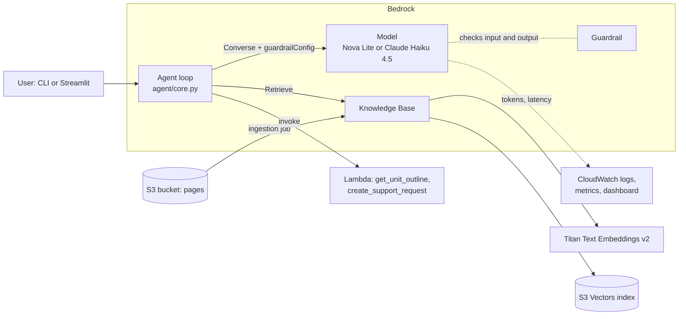

# Campus Assistant on Amazon Bedrock

A small, complete Amazon Bedrock assistant, defined entirely in Terraform:

* a **Knowledge Base** (managed RAG) over a few public university web pages, stored in **S3 Vectors**
* an **agent** written as a short tool-calling loop on the **Converse API**, with two **Lambda** tools
* a **Guardrail** for content filtering, PII masking, prompt-attack detection and one denied topic
* **CloudWatch** invocation logging and a dashboard of latency and token usage per model
* the same agent run on **two models**, with a script that compares them on cost, speed and quality

> **Status.** Deployed on AWS and working: the Knowledge Base, S3 Vectors index, guardrail (version 2), Lambda
> tools, logging and dashboard. **Not yet run on Bedrock models:** the new account's Bedrock model quotas are all 0
> (a support case is open), so no Bedrock model or embedding call has succeeded and the Knowledge Base is not yet
> indexed. Until that clears, the same agent loop is tested with a **local stand-in** (an open model and local page
> search) while the guardrail and the tools run on AWS. Every result below says which of these it came from.

Unofficial demo. The pages come from the public Curtin University website and are downloaded at build time; they are
not stored in this repository. Not affiliated with or endorsed by Curtin University. The unit data used by the tools
(`DEMO1001` and so on) is fictional.

## Why there is no "Bedrock Agent" resource

The first version of this stack used Amazon Bedrock Agents (`aws_bedrockagent_agent`, action groups, aliases). On a
new account `CreateAgent` returns:

> 403 AccessDeniedException: Bedrock Agents is in Maintenance Mode. New agent creation is not available for accounts
> without prior service usage.

Amazon Bedrock Agents was renamed **Agents Classic** and closed to new customers on 30 July 2026. Existing agents keep
working, with no end-of-life date, but the model list is frozen and no features are planned. AWS recommends
[Amazon Bedrock AgentCore](https://docs.aws.amazon.com/bedrock/latest/userguide/agents-classic-maintenance-mode.html)
instead: either its configuration-based harness or a code-defined agent in any framework. Knowledge Bases and
Guardrails are not affected.

So the agent here is code: `agent/core.py`, about 150 lines on the Converse API. It does what an Agents Classic agent
did (plan, search the Knowledge Base, call tools, pass the guardrail), with every step visible, and it is the shape
of agent that AgentCore Runtime hosts.

| Agents Classic | This project |
| --- | --- |
| Agent instruction | `SYSTEM_PROMPT` in `agent/core.py` |
| Action group with function schema | `TOOLS` (Converse `toolConfig`) and the same Lambda |
| Knowledge Base association | `search_knowledge_base` tool calling the `Retrieve` API |
| Guardrail configuration | `guardrailConfig` on every Converse call |
| Agent trace | The result dictionary: searches, tool calls, policies fired, tokens |
| Agent execution role | `aws_iam_policy.agent_runtime` in `infra/agent.tf` |

## Architecture



| Part | File | What it creates |
| --- | --- | --- |
| Knowledge Base | `infra/knowledge_base.tf` | Docs bucket, S3 Vectors bucket and index, IAM role, Knowledge Base, S3 data source (300-token chunks, 20% overlap) |
| Tools | `infra/lambda.tf`, `lambda/handler.py` | One Lambda with two functions |
| Guardrail | `infra/guardrail.tf` | Content filters, prompt-attack filter, PII rules, a student-ID regex, a denied topic, and a numbered version |
| Agent | `agent/core.py`, `infra/agent.tf` | The tool-calling loop, and a least-privilege IAM policy for whatever runs it |
| Local stand-in | `agent/local_backend.py` | Runs the same loop on a local model while Bedrock quota is unavailable |
| Observability | `infra/observability.tf` | Invocation logging to CloudWatch Logs and a dashboard |

## Run it

You need an AWS account, [Terraform](https://developer.hashicorp.com/terraform/install) 1.6+, the
[AWS CLI](https://aws.amazon.com/cli/) and Python 3.10+. Expect a cost of a few US dollars at most if you tear it down
afterwards: there is no always-on component.

```powershell
git clone https://github.com/IbrahimUWA/bedrock-campus-assistant
cd bedrock-campus-assistant
pip install -r requirements.txt
aws configure                       # access key, secret, region ap-southeast-2

.\deploy.ps1                        # preflight, terraform apply, fetch pages, index them (about 5 minutes)

python scripts\03_ask.py "When are results released after the mid-year exams?"
python scripts\03_ask.py --model haiku "What are the assessments for unit DEMO2002?"
python scripts\04_guardrail_tests.py
python scripts\05_compare_models.py
streamlit run scripts\app.py        # chat interface at http://localhost:8501

.\deploy.ps1 -Destroy               # remove everything
```

The same steps one at a time, with what each does, are in [`STEP_BY_STEP.md`](STEP_BY_STEP.md).

| Step | Script | What it does |
| --- | --- | --- |
| 0 | `scripts/00_preflight.py` | Checks credentials, the embedding model, each agent model and S3 Vectors in your region |
| 1 | `scripts/01_fetch_pages.py` | Downloads the pages in `data/sources.json` as clean text with a source-URL metadata file each |
| 2 | `scripts/02_ingest.py` | Uploads to S3, runs the ingestion job, then a retrieval check with no LLM |
| 3 | `scripts/03_ask.py` | Runs the agent; prints searches, tool calls, citations, tokens, latency and cost |
| 4 | `scripts/04_guardrail_tests.py` | Tests each guardrail rule with `ApplyGuardrail`, then end to end through the agent |
| 5 | `scripts/05_compare_models.py` | Runs `data/eval_questions.json` through the agent on each model; writes `results/comparison.md`; publishes CloudWatch metrics |
| - | `scripts/app.py` | Streamlit chat with a panel showing what the agent did |

## Design choices

* **S3 Vectors, not OpenSearch Serverless.** OpenSearch Serverless bills for capacity around the clock. S3 Vectors
  bills for storage and queries, which suits a small or bursty assistant. The trade-off is fewer search features
  (no hybrid keyword search).
* **Sydney region and an Australian inference profile** so prompts and documents stay in Australia.
* **The model is a parameter of the agent loop**, so adding a third model to compare is one line in `variables.tf`.
* **The agent attaches a numbered guardrail version**, so a guardrail change is a new version that can be rolled
  back, not an edit in place.
* **Least privilege.** The agent policy allows only model calls, this Knowledge Base, this guardrail and this
  Lambda; the docs bucket blocks public access.
* **Only the user's words are guarded on input** (`guardContent`), so the system prompt and retrieved pages are not
  mistaken for an attack or masked.
* **Page text is fetched, not committed**, and the fetch honours `robots.txt`.

## Results

### Guardrail (the deployed Bedrock Guardrail, tested with `ApplyGuardrail`)

Version 1 passed 7 of 8 direct cases; version 2 passes 9 of 9
([`results/guardrail_tests.md`](results/guardrail_tests.md), first run in `guardrail_tests_v1.md`). Testing found:

* **A false positive.** The denied topic was defined as requests to write "an assessable assignment", and it blocked
  a normal answer listing a unit's assessments. Adding "facts about assessments are not part of this topic" made it
  worse (it then blocked the question too): a topic is matched on meaning, so naming a thing pulls it in. Version 2
  describes only the behaviour to deny.
* **Phone masking hid a safety number.** The `PHONE` rule masked the university's own Safer Community line in an
  answer, so the rule was removed.
* **Masking does not rewrite the question.** `ANONYMIZE` left an email address and student ID in the user's input
  untouched; it masks answers. To keep personal data out of the prompt and the logs, block it on input or mask it in
  your own code.
* Topic definitions are limited to 200 characters, and this Terraform provider version cannot switch a topic off for
  output only.

### Agent, on local stand-in models

`data/eval_questions.json`: ten questions, three runs each (seven from the pages, two needing a tool, one that cannot
be answered). Models: Qwen3-8B and Qwen3-14B on one workstation GPU, with local search over the same pages. The
guardrail and Lambda tools are the AWS ones. **These are not Bedrock latency, token or cost figures.**

| Model | First run | After fixes | Page questions | Tool questions | Unanswerable | Median latency (s) |
| --- | --- | --- | --- | --- | --- | --- |
| qwen3-8b | 15/30 | 24/30 | 15/21 | 6/6 | 3/3 | 2.79 |
| qwen3-14b | 18/30 | 21/30 | 12/21 | 6/6 | 3/3 | 3.35 |

What changed between the runs ([`comparison_local_v1.md`](results/comparison_local_v1.md) to
[`comparison_local.md`](results/comparison_local.md)):

* **Ingestion.** The fetch script dropped `<button>` elements, and on the key-dates page the headings of each table
  ("Semester 2 2026") are accordion buttons. Every date row lost its semester, so date questions could not be
  answered by any model. The script now keeps accordion headings, and chunks are split at headings.
* **Tool description.** The search tool's description did not mention rankings, so a model answered that question
  from memory. One phrase fixed it for the smaller model; the larger one still sometimes skips the search.
* **Scorer.** "The search results do not provide..." was not counted as a correct refusal. Three of the smaller
  model's gained passes come from this fix, not from a better answer.
* **Still failing:** "mid-year exams" and "November" do not match "Semester 1 2027" and "Semester 2 2026" in the
  page. That is a vocabulary gap for query rewriting or hybrid search, not yet fixed.

### Still to run on Bedrock

Ingestion into the Knowledge Base, the same comparison on Nova Lite and Claude Haiku 4.5 with cost per question, and
the CloudWatch dashboard. The commands are unchanged: `python scripts\02_ingest.py`, then
`python scripts\05_compare_models.py --repeats 3`.

## Run it without Bedrock model access

```powershell
pip install torch transformers sentence-transformers      # plus a GPU with about 16 GB for Qwen3-8B
$env:CAMPUS_BACKEND = "local"
python scripts\03_ask.py "Which Curtin library is open by appointment only?"
python scripts\05_compare_models.py --repeats 3            # writes results\comparison_local.md
streamlit run scripts\app.py
```

`agent/local_backend.py` replaces only the model call and the retrieval call; `agent/core.py` is unchanged. The
deployed guardrail is applied with `ApplyGuardrail`, the API intended for models that are not hosted on Bedrock.
`python tests\test_agent_offline.py` tests the loop with no AWS account at all.

## Licence

MIT for the code. The downloaded page content remains the property of its publisher.
